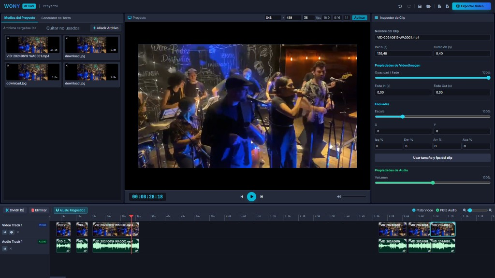

# Wony Wegas

A super easy video editor that runs in the browser. No install, no account, and no backend. Your files stay on your computer.



## Open it

[https://brotochola.github.io/wony_wegas/](https://brotochola.github.io/wony_wegas/)

To run this folder yourself, serve it with any static file server and open `index.html`. From this folder:

```
npx --yes serve .
```

Opening the file directly (`file://`) will not load the editor. The scripts are modules, and browsers block those from a local file.

## Edit

1. Drop a video, audio file, or image into **Project Media**, or click **Add File**.
2. Drag it onto the timeline. Double-click a file to add it at the end.
3. Trim the edges, split at the playhead, and move clips. Linked audio stays with the picture until you unlink it.
4. Press **Space** to play. Select a clip and use the inspector for size, crop, fades, and volume.
5. Click **Export Video** when it looks right. Chrome writes an MP4 when WebCodecs is available, and falls back to WebM otherwise.

Press `?` for the shortcut list.

## Record

**Record** in Project Media films you with the webcam, records the microphone alone, or both. Pick the camera and the microphone, watch the preview and the level, and press **Start recording**. When you stop, the take goes into Project Media and, if you leave the box checked, at the end of the timeline. In Chrome it is also saved as a file, so a saved project can open it again.

## Transcript and silences

The **Transcript** tab works on the selected clip, or on the only video when nothing is selected, and on every other piece of that file on the same track.

- **Remove silences.** Click **Find silences** to mark the pauses on the timeline. Use the slider to keep more or less air between phrases. **Apply cuts** cuts them and closes the gaps, and **Ctrl+Z** brings everything back in one step. A voice detector (Silero VAD, 2 MB) finds the pauses on this computer, so the cuts do not depend on the transcription.
- **Transcribe.** Whisper base or small runs on this computer, with WebGPU when the browser has it and on the CPU otherwise. The model downloads once (77 to 320 MB). Groq runs Whisper large-v3 with a free API key, which you paste in **Options**. With Groq the audio is uploaded; with the other engines it stays here. Words the engine was unsure about are underlined. Click a word to jump there. Words that were cut are crossed out.

- **Subtitles.** With a transcript on screen, pick a style and click **Add subtitles**. They go on their own track on top and are burned into the export. Styles: **TikTok** (big words, the one being said in yellow), **Box** (the word being said on a colored box), **One word**, and **Classic** (a sentence at the bottom on a dark band). Select the subtitles clip to change the style, size, colors and how many words show at a time, to drag them on the preview, or to fix words: type over them and the timing is kept. Subtitles follow later cuts on their own. **Download .srt** and **.vtt** give the same text as files, up to 42 characters a line.

Each file is analyzed once. The results are kept in the browser.

## Save

The floppy-disk icon saves the edit on this computer. The download icon saves the same edit as a JSON file you can move. Neither one copies the media. When you open the project again, point it at the same files. In Chrome, a saved permission can reopen them without copying.

## What you can do

- Video, audio, and image clips, plus text
- Several video and audio tracks
- Trim, split, ripple delete, duplicate, copy, and paste
- Snap, fades, opacity, volume, scale, position, and crop
- Undo and redo
- In and out points for the export range
- 16:9, 9:16, and 1:1, or your own size and frame rate

A current desktop browser is enough. Chrome is the one that can remember file permission and export MP4.
